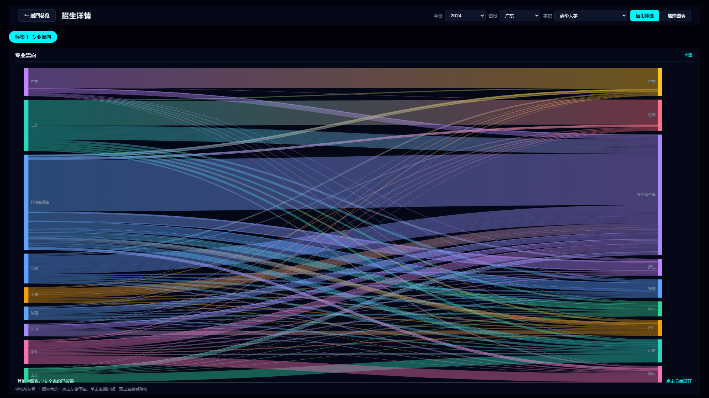
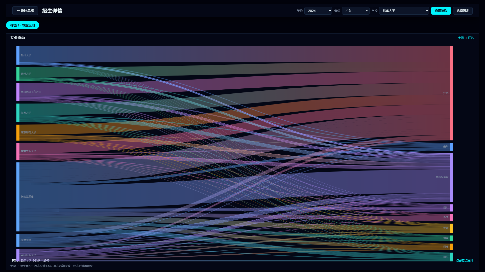
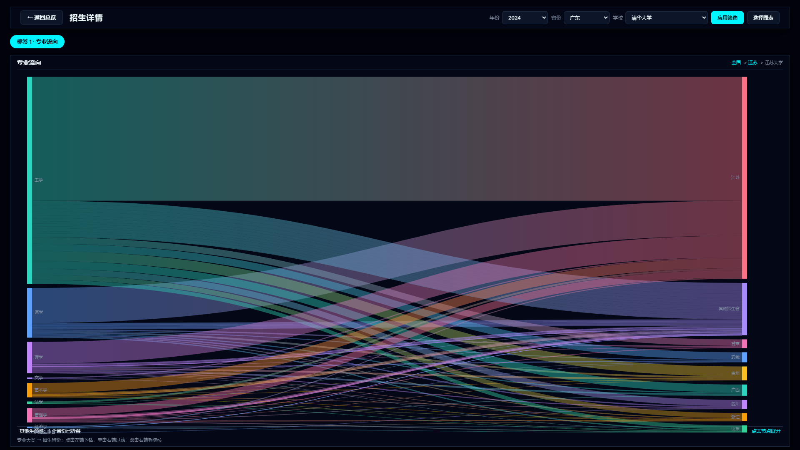
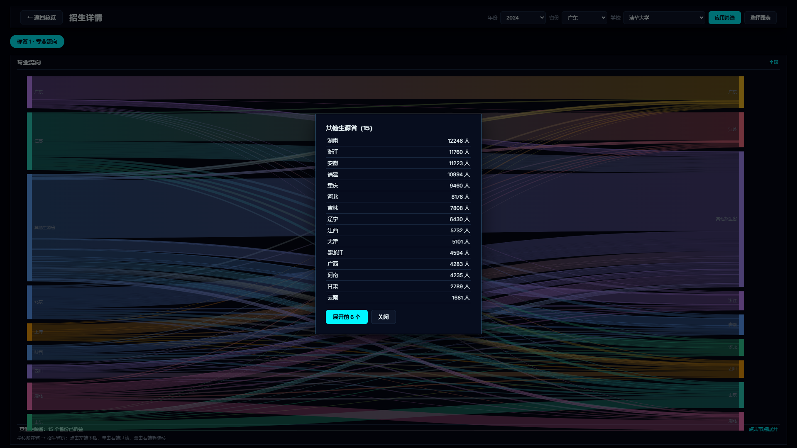
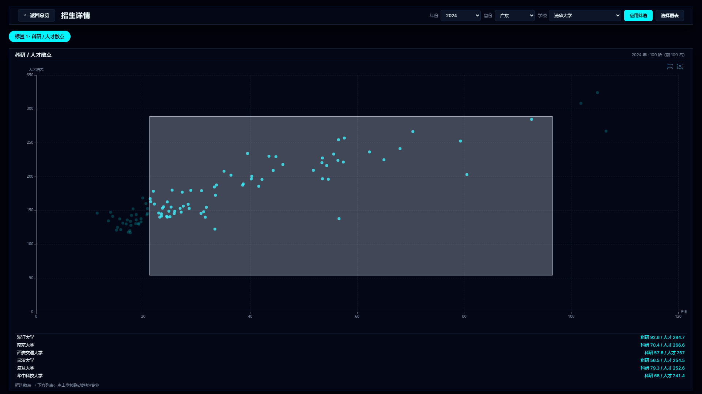

# P2：专业流向桑基图与科研/人才散点

> 分支：`feat/p2-cross-sankey`（尚未合并 main）

## 1. 数据

- 2024 年跨省招生：原始 51,981 行，清洗后 42,728 行，覆盖 100 所学校、22 个招生省份，单独存入 `admission_cross` 表。
- 热力图/专业表使用的 `admission` 表：2024 年为“22 个有跨省数据的省份 + 9 个缺失省份保留本省数据”，共 45,664 行，31 省完整；2021–2023 年仍是本省口径。
- 桑基图只读 `admission_cross`，因此只展示有跨省数据的 22 个省份；缺失的 9 个省份（山西、内蒙古、河南、云南、西藏、陕西、青海、宁夏、新疆）在桑基图中暂无流向。
- 华北电力大学：北京校区对应排名主条目“华北电力大学”；保定校区单独建为“华北电力大学（保定）”（河北）。
- 专业大类：`build_major_categories.py` 按关键词把 828 个专业归为 12 类 + 其他，输出 `data/major_categories.csv`。

## 2. 桑基图交互

- 默认：学校所在省 → 招生省份，只显示流量最大的 8 个生源省、8 个招生省，其余折叠为“其他生源省 / 其他招生省”。
- 点击左端省份：下钻为「该省大学 → 招生省份」。
- 点击左端大学：下钻为「该校专业大类 → 招生省份」。
- 点击右端省份：过滤到该省，不新增层级；面包屑可取消。
- 双击右端省份：弹出「该省招生院校」列表。
- 点击“其他”节点：弹出被折叠省份列表，「展开前 6 个」分批补入图中。
- 顶部面包屑：全国 / 江苏 / 江苏大学，逐级返回。

## 3. 散点图交互

- 详情页图表选择中新增「科研 / 人才散点」。
- 横轴科研得分、纵轴人才培养得分，默认 2024 年前 100 名。
- 框选散点后，下方列出选中的学校（最多 12 所）；点击学校联动排名趋势与专业招生。
- 首页未新增任何图表或表格。

## 4. 接口

- `GET /api/sankey?level=province|university|major&year=&target=&province=&school=`
  - province：学校所在省 → 招生省份；
  - university：指定 province 的大学 → 招生省份，或指定 target 的招生院校；
  - major：指定 school 的专业大类 → 招生省份。

## 5. 自检

- `python check_dashboard.py`：**27 项通过 / 0 失败**（新增桑基图、散点图渲染）。
- `python check_api.py`：**81 项通过 / 0 失败**（新增桑基三级数据、target 院校列表）。

## 6. 已知限制

- 跨省数据只有 2024 年，且只覆盖 22 个招生省份；缺失 9 省的桑基图暂无数据。
- 默认只画 8×8 个节点（约 100 条连线），不是严格 Top 120；节点上限在 `dashboard.html` 的 `slice(0, 8)` 可调。
- 图表全部在详情页，首页只保留入口按钮，没有新增表格。

## 7. 截图

