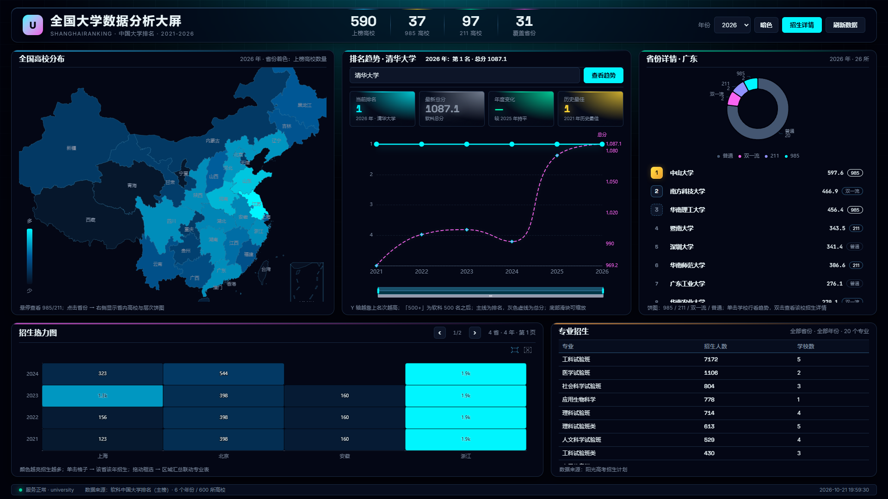
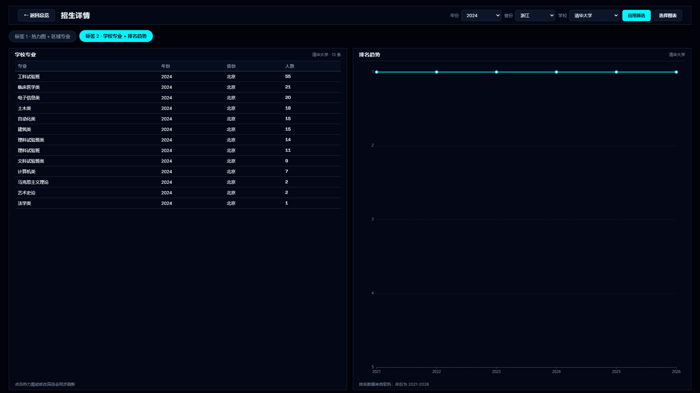
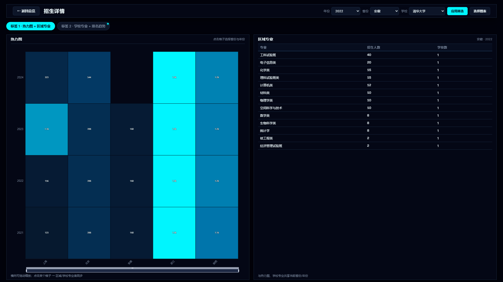

# 招生详情页与省级招生数据扩展

> 执行日期：2026-10-21；分支：`feat/detail-view`、`feat/admission-coverage`

## 1. 本轮目标

1. 主页热力图保持紧凑的「四行四列」观感（4 个年份 × 4 个省份一屏），可翻页查看全部省份。
2. 增加「招生详情」入口：详情页可按年份/省份/学校筛选，进入时带默认值。
3. 详情页图表按选择两两分组为标签页：同组两图同屏对等联动；隐藏标签页只标记变化，切回时按共享状态重绘；返回主页时把状态带回主页。
4. 招生数据从 4 个招生省份扩展到「每省前 10 所高校（按 2024 软科全国排名）在本省的招生计划」。

## 2. 招生采集口径

- 学校集合：2024 年软科排名，每个省取前 10 所（海南 4、宁夏 2、西藏 2、青海 2，共约 280 所）。
- 招生省份：学校所在省（本省招生口径），即「本省前 10 高校在本省的招生计划」。
- 年份：2021-2024。
- 科类：3+3 省份用综合（type=3）；3+1+2 省份优先物理类（2073），再回退历史类/综合；传统省份用理科。
- 接口：掌上高考公开接口 `api.zjzw.cn`，size=20 分页，请求间隔 0.6-1.2 秒。

### 为什么有些省份没有数据

1. 掌上高考接口对「学校 + 招生省份 + 年份 + 科类」不是全覆盖，部分组合返回空。
2. 部分省份属于新高考，科类 ID 不同；脚本会尝试多组科类，仍为空时显示「暂无数据」。
3. 采集期间接口触发限流（code 1069），脚本会等待重试；未完成的省份在页面上显示「暂无数据」，不会伪造。

## 3. 主页变化

- 热力图按 4 个省份一页展示，`‹ / ›` 翻页，标签显示当前页/总页数。
- 「招生详情」按钮进入详情页。
- 双击省份列表中的学校行，可直接进入该校招生详情（标签为「学校专业 + 排名趋势」）。

## 4. 详情页交互

- 顶部筛选：年份、省份、学校；默认取主页当前年份/省份/学校，若该组合没有数据则回退到最新年份和招生人数最多的省份。
- 标签页：选中的图表按选择顺序两两分组，每个标签最多两个图表，同组左右并列、地位对等。
- 同组联动：点击热力图格子会同时更新省份/年份，并刷新区域专业表和学校专业表。
- 跨标签：修改筛选后，当前标签立即重绘，其他标签显示小圆点；切回时按最新状态重绘并清除圆点。
- 返回：返回总览时把详情页的年份/省份/学校带回主页，并自动翻到该省份所在的热力图页。

## 5. 相关接口

- `GET /api/admission_meta`：可选年份、省份、学校（用于筛选下拉）。
- `GET /api/school_majors?school=&year=&province=`：某校招生专业明细。
- `GET /api/majors?province=&year=`：区域专业招生汇总。
- `GET /api/heatmap`：省份×年份招生人数矩阵。

## 6. 自检

- `python check_dashboard.py`：24 项通过，覆盖热力图分页、详情页打开/默认值/标签/返回。
- `python check_api.py`：68 项通过，覆盖新增的招生元数据与学校专业接口。

## 6.5 当前数据状态（2026-10-21 20:00）

- 原始招生 CSV：733 行（7 所学校、5 个招生省份：北京、上海、浙江、安徽、陕西）。
- 入库：498 行，覆盖 2021-2024 四年。
- 剩余省份未完成：掌上高考接口对本机 IP 触发限流（code 1069 “访问太过频繁”），脚本在 90 秒重试后仍被限流，已停止本轮采集。
- 恢复方式：稍后网络限流解除后执行
  `python spider_admission.py --selection top-per-province --rank-year 2024 --top-per-province 10 --local --years 2021,2022,2023,2024 --out data/admission_local_raw.csv --rate 1.5 --resume --limit 0`
  然后 `python load_admission.py --csv data/admission_local_raw.csv`。
- 页面表现：已采到的省份正常显示；未采到或接口无数据的省份在热力图/详情页显示「暂无数据」，不做伪造。

## 7. 已知限制

- 招生数据受接口限流影响可能分批到位；未完成省份显示「暂无数据」。
- 本省口径只统计本省高校在本省的招生，不是全国高校在该省招生的全量。
- 2025/2026 年招生计划接口无数据，详情页年份只到 2024。
## 8. 截图

主页热力图分页（当前数据覆盖 5 省，翻页可见）：

详情页双标签：

详情页点击热力图格子联动：

