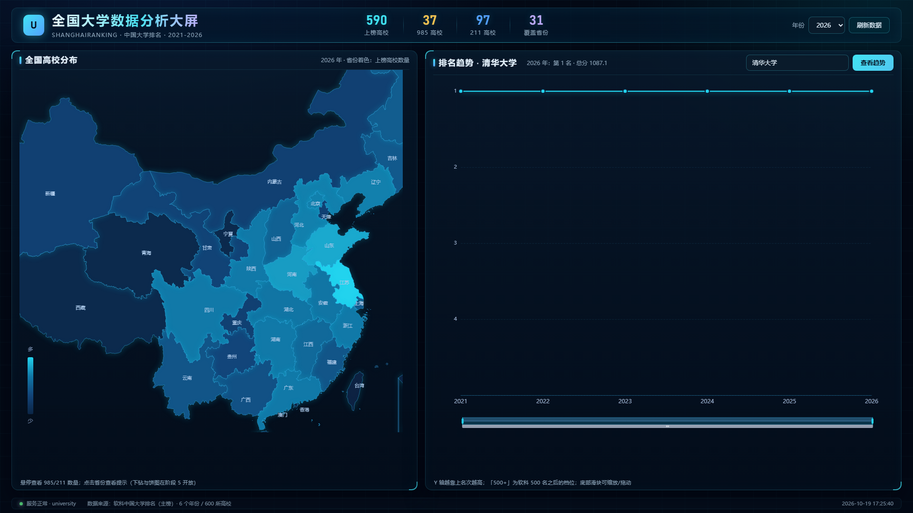
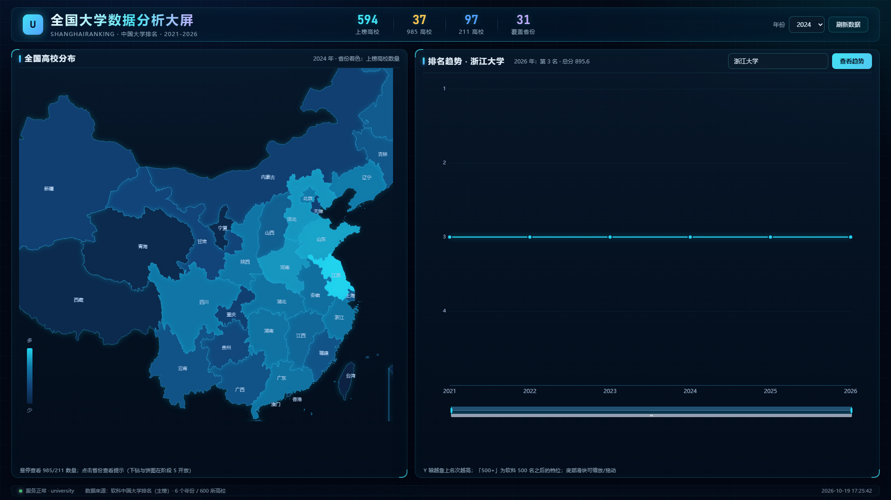

# 阶段 4 · 前端大屏 P0 说明（F03 地图 + F04 趋势）

> 对应设计文档 v2 `5 布局、`2.1 F03/F04；执行日期 2026-10-19；状态：待人工确认
> 技术栈：原生 HTML/CSS/JS + ECharts 5.5.1（本地文件）+ Flask 同源托管

## 1. 交付物

| 产出 | 路径 | 说明 |
|---|---|---|
| 大屏页面 | `dashboard.html` | 1920×1080 深色科技风，地图 + 趋势 + KPI + 年份筛选 |
| 本地图表库 | `static/vendor/echarts.min.js` | ECharts 5.5.1（1.0 MB），不依赖外网 CDN |
| 中国地图数据 | `static/vendor/china.json` | 34 个省级行政区 GeoJSON（61 KB） |
| 服务入口 | `app.py` 的 `/@` 路由 | 直接访问 `http://127.0.0.1:5000/` |
| 前端自检 | `check_dashboard.py` | Playwright 驱动本机 Chrome/Edge，12 项检查 |
| 截图 | `docs/screenshots/*.png` | 默认态、2024+浙江大学、自检截图 |

## 2. 打开方式

```powershell
# 1) 启动服务（同时提供 API 和大屏页面）
$env:MYSQL_PASSWORD="你的密码"
python app.py

# 2) 浏览器打开
#    http://127.0.0.1:5000/
```

也支持 URL 参数直接定位：`/?year=2024&school=浙江大学`（便于录屏/验收复现）。

> 不建议双击 `dashboard.html` 用 `file://` 打开：页面会回退到 `http://127.0.0.1:5000` 取数，
> 需要 API 已启动且浏览器允许跨域；通过 Flask 访问最稳。

## 3. 已实现功能

| 功能 | 实现 |
|---|---|
| F03 中国地图 | 34 个省级行政区渲染，按「上榜高校数量」渐变着色；港澳台无软科数据自动置灰 |
| 地图交互 | 悬停显示省份 + 上榜数 + 985/211；点击省份弹出提示（下钻留给阶段 5） |
| KPI 概览 | 上榜高校、985、211、覆盖省份，随年份联动（2026: 590 / 37 / 97 / 31） |
| 年份筛选 | 2021-2026 下拉，切换后地图、KPI、标题同步刷新 |
| F04 趋势折线 | 选校后展示 6 年排名曲线，Y 轴倒置（名次越高越靠上） |
| dataZoom | 内置滚轮缩放 + 底部滑块拖动/缩放 |
| 选校 | 输入框带联想（`/api/schools`），回车或点「查看趋势」加载趋势 |
| 「500+」展示 | 数据库哨兵值 1000 在坐标轴、tooltip、标签、汇总行统一显示为「500+」 |
| 响应式 | 窗口尺寸变化自动 resize；≤1280px 时上下布局 |
| 错误处理 | 接口失败顶部红色横幅（含「重试」按钮）+ 页脚状态灯；页面无 JS 报错 |
| 加载状态 | 面板骨架式微光（skeleton），不是空白/转圈 |
| 视觉规范 | 字体分级（Bahnschrift 标题/数字 + 微软雅黑正文）、OKLCH 带色调中性色、8px 间距体系、160-200ms 缓动、focus-visible 焦点环、prefers-reduced-motion |
| 可访问性 | role=alert、状态文案为可操作中文提示，颜色不单独承载信息 |

## 4. 自检结果

运行 `python check_dashboard.py` → **通过 13 项，失败 0 项**：

```
✅ 页面无 JS 运行时错误
✅ 控制台无 error 日志
✅ 地图 + 折线 canvas 均渲染  (2 个 canvas，宽度 [820, 968])
✅ 页脚显示服务正常  (服务正常 · university)
✅ KPI 2026 上榜 590 / 985=37 / 211=97 / 覆盖省份=31
✅ 切换 2024 年地图刷新为 594
✅ 地图标题年份更新
✅ 搜索换校后趋势标题切换
✅ 点击省份弹出提示  (甘肃：上榜 13 所)
✅ 截图已保存
```

## 5. 手动检查步骤

```powershell
# 0) 前置：MySQL + API 已启动
$env:MYSQL_PASSWORD="你的密码"
python app.py

# 1) 浏览器打开 http://127.0.0.1:5000/
#    预期：顶部 KPI 590 / 37 / 97 / 31，左侧地图着色，右侧清华 6 年折线

# 2) 年份切换：2026 -> 2024
#    预期：KPI 上榜数变为 594，地图标题变「2024 年」

# 3) 节点详情：鼠标悬停江苏
#    预期：tooltip 显示 江苏 上榜 39 所 / 985 2 / 211 10

# 4) 选校：输入「浙江大学」-> 查询
#    预期：标题变「排名趋势 · 浙江大学」，曲线为第 3 名附近，右上汇总显示「2026 年：第 3 名 · 总分 895.6」

# 5) dataZoom：拖动底部滑块
#    预期：X 轴年份范围缩放，曲线可拖动

# 6) 点击地图任一省份
#    预期：底部弹出「XX：上榜 N 所（下钻在阶段 5 开放）」

# 7) 控制台（F12）
#    预期：无红色报错

# 8) 一键自动化自检
python check_dashboard.py
```

## 6. 截图

默认态（2026 年 / 清华大学）：



切换年份 + 换校（2024 年 / 浙江大学）：



## 7. 已知限制与阶段 5 衔接

1. **地图下钻未实现**：点击省份目前只弹提示，阶段 5 接 `/api/province` 做省内列表 + 层次饼图。
2. **右侧散点图位未放**：阶段 4 按 P0 只做地图 + 趋势；阶段 6 再加 F08。
3. **热力图未上**：阶段 5 招生数据到位后，用 `/api/heatmap` 放底部区域。
4. **所有省份标签同屏显示**：东部小省（京津沪）标签较密，已开启 `labelLayout.hideOverlap`；放大窗口可缓解。
5. **ECharts 本地化**：已下载到 `static/vendor`，规避 CDN 打不开的风险（设计文档 `9）。

## 8. 下一步（阶段 5，需确认）

- 省份下钻：点击地图 → `/api/province` → 省内学校列表 + 层次饼图
- 招生爬虫：阳光高考公开部分，写 `admission` 表
- F07 热力图 + 框选联动专业线
