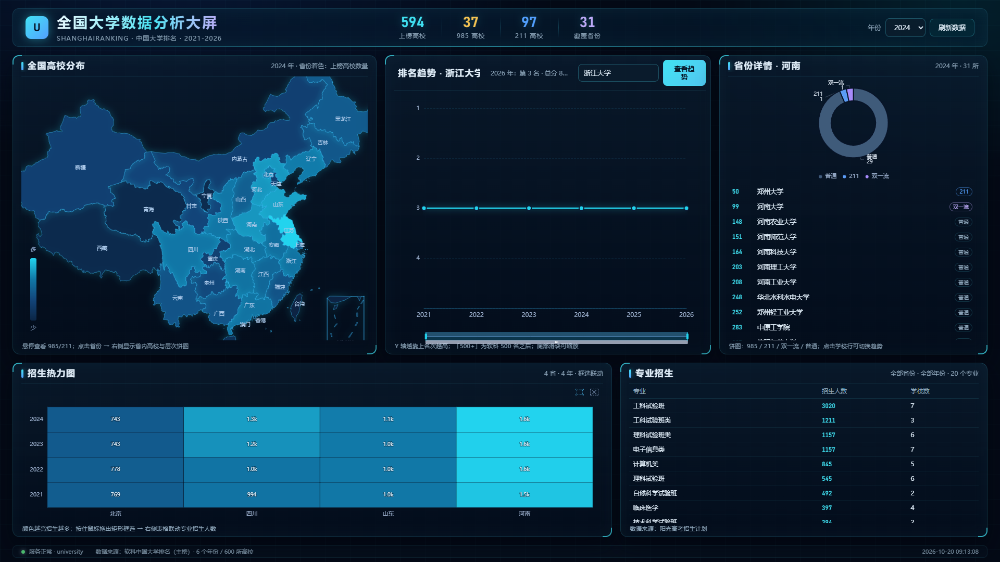
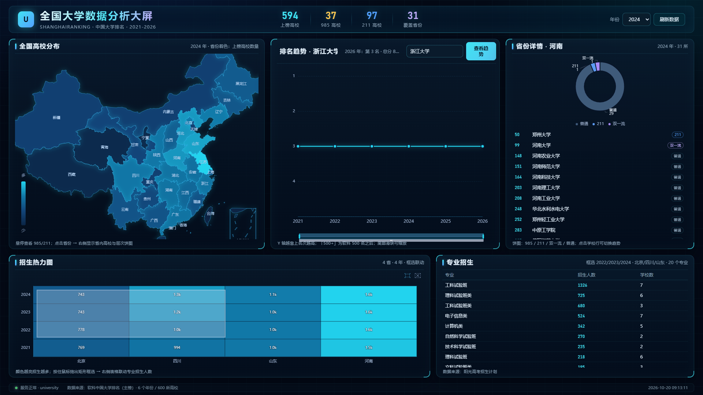

# 阶段 5 · P1 功能说明（F05 下钻 / F06 招生 / F07 热力图）

> 对应设计文档 v2 §2.1 F05-F07、§5.2 交互；执行日期 2026-10-20；状态：已完成（跳过人工验证门）
> 说明：宏观排名数据（P0）沿用阶段 1-4；本阶段补齐 P1 三项功能。

## 1. 交付物

| 产出 | 路径 | 说明 |
|---|---|---|
| 招生爬虫 | `spider_admission.py` | 掌上高考公开 JSON 接口，增量写 CSV、断点续跑 |
| 招生入库 | `load_admission.py` | 清洗 + 全量重导 admission 表 |
| 原始招生数据 | `data/admission_raw.csv` | 3014 行 × 10 列 |
| 清洗后数据 | `data/admission_clean.csv` | 2256 行 |
| 后端新增接口 | `app.py` 的 `/api/majors` | 按省份/年份聚合专业招生人数（框选联动） |
| 大屏 | `dashboard.html` | 三栏 + 底部热力图；省份下钻饼图/列表；框选联动表格 |
| 数据源探测报告 | `docs/admission_source_probe.md` | 阳光高考 412、掌上高考接口可用性记录 |
| 截图 | `docs/screenshots/p1_*.png` | 默认态、省份下钻、框选联动 |

## 2. F06 招生计划采集

### 2.1 数据源

- **阳光高考**（gaokao.chsi.com.cn）：requests 与 Playwright 真 Chrome 均返回 **412**（CDN 挑战），放弃。
- **掌上高考**（gaokao.cn，公开 JSON）：

```
GET https://api.zjzw.cn/web/api/?school_id=140&local_province_id=41
    &local_type_id=1&year=2024&page=1&size=20
    &uri=apidata/api/gkv3/plan/school
Referer: https://www.gaokao.cn/
```

返回字段：`year`、`local_province_name`、`sp_name`（专业）、`num`（招生人数）、
`local_type_name`、`local_batch_name`、`tuition`。`size` 上限 20，需要翻页。

### 2.2 采集策略与结果

- 学校名单取 `data/clean_rankings.csv` 前 24 所（按 2021 名次）
- 招生省份：河南(41)、四川(51)、北京(11)、山东(37)
- 年份：2021-2024（接口 2025/2026 无数据）
- 非新高考省份取理科（`local_type_id=1`），新高考取综合（`3`）
- 请求间隔 0.8s，失败重试 1 次；增量写 CSV

实际结果（达到 `--min-rows 3000` 后提前结束）：

| 指标 | 数值 |
|---|---|
| 原始行数 | **3014** |
| 覆盖学校 | 10 所（清华、北大、浙大、上交、南大、复旦、中科大、华科、武大、西交） |
| 覆盖年份 | 2021 / 2022 / 2023 / 2024 |
| 覆盖招生省份 | 4 个（河南、四川、北京、山东） |
| 专业数 | 157 |
| 招生人数合计 | 17,881 人 |

运行命令：

```powershell
python spider_admission.py                              # 默认 20 校 x 4 省 x 4 年
python spider_admission.py --limit 30 --min-rows 3000
python spider_admission.py --resume                     # 断点续跑
```

> 注意：接口并非所有省份都有数据（探测时 23/31 省有数据，广东/江苏/湖北/湖南/福建/河北/辽宁/重庆为空）；
> 本次选取的 4 个省份均有稳定数据。

## 3. 清洗与入库

运行：`python load_admission.py`

| 步骤 | 规则 | 结果 |
|---|---|---|
| 字段别名 | univ_name/name/学校、year/年份、province/省份、major/专业、count/招生人数 等自动识别 | 10 列全部识别 |
| 缺失 | 校名/省份/专业为空丢弃 | 0 条 |
| 数值 | year/count 转整数，非法值丢弃 | 12 条 |
| 学校匹配 | 校名精确 → 去空格规范化 → univ_slug 反查 | 未匹配 0 条 |
| 合并 | 同 (学校, 年份, 省份, 专业) 的 文/理/批次 行求和 | 合并 746 行 |
| 入库 | 先 `DELETE FROM admission` 再批量插入 | **2256 行** |

入库校验：

```
admission 总行数：2256
2021 年：514 条，合计 4289 人
2022 年：556 条，合计 4381 人
2023 年：583 条，合计 4548 人
2024 年：603 条，合计 4663 人
Top5 省份：河南 6196，四川 4460，山东 4192，北京 3033
Top5 专业：工科试验班 3020，工科试验班类 1211，电子信息类 1157，理科试验班类 1157，计算机类 845
孤儿记录：0
```

## 4. F05 省份下钻 + 层次饼图

- **交互**：点击地图省份 → 右侧「省份详情」面板刷新；地图选中态高亮
- **饼图**：985 / 211 / 双一流 / 普通 四类，颜色语义固定（琥珀/蓝/紫/灰）
- **列表**：省内高校按名次升序，显示「名次 + 校名 + 层次徽标」，可滚动；点击任意学校 → 中心趋势图切换
- **联动年份**：顶部年份切换时，地图与省份详情同步刷新
- **默认**：页面加载展示广东（可点击其它省）
- 接口：`GET /api/province?province=广东&year=2026`（阶段 3 已实现）
- 验收：点击省份显示省内数据 ✅；饼图随省份变化 ✅；学校列表可点击切趋势 ✅

## 5. F07 招生热力图 + 框选联动

- **热力图**：MySQL `admission` 按「招生省份 × 年份」聚合，只展示有数据的省份/年份（当前 4×4）
- **颜色**：值越大越亮（隐藏 visualMap 仅用于映射，避免图例遮挡）；格子里直接标注人数（1.6k 形式）
- **框选**：ECharts brush（矩形），默认已激活；拖框后读取 `coordRanges` 换算省份/年份
- **联动**：`GET /api/majors?province=..&year=..` → 右侧表格显示专业、招生人数、学校数（Top20）
- **空态**：无数据时热力图区域显示「暂无招生数据」，表格显示提示
- **附加**：点击热力方格可反向下钻到该省份

## 6. 自检结果

| 检查 | 结果 |
|---|---|
| `python check_api.py` | **58 项通过 / 0 失败**（含 heatmap 有数据分支、majors 接口） |
| `python check_dashboard.py` | **18 项通过 / 0 失败**（含省份下钻、框选联动） |
| 框选联动 | 拖动后表格标题变为「框选 2022/2023/2024 · 北京/四川/山东 · 20 个专业」，数据随选区变化 |
| 数据库 | admission 2256 行，孤儿记录 0 |

关键自检输出：

```
✅ 点击省份加载省内详情  (省份详情 · 甘肃)
✅ 省内学校列表非空  (13 所)
✅ 招生热力图已渲染
✅ 框选热力图联动专业表格  (框选 2021/2022/2023/2024 · 北京/四川/山东/河南 · 20 个专业)
```

## 7. 截图

默认态（2026 / 广东，热力图 4 省 × 4 年）：


2024 / 河南下钻：



框选联动：



## 8. 已知限制（如实说明）

1. **覆盖范围有限**：只采集了 10 所学校 × 4 个招生省份 × 4 年（接口无数据的省份已排除）；
   P1 验收要求「≥2000 行」已达成（2256 行），但不是全量 600 校。
2. **理科口径**：非新高考省份只取理科（type=1），文科未采集；聚合时文理不混算（未采文科）。
3. **热力图表格是「招生计划人数」**，不是「专业录取线」（`major_score` 表仍为空，F10 建议不做）。
4. **布局偏差**：设计文档写「框选热力图下方联动表格」，实际放在热力图右侧（1920 宽屏更易读）。
5. **年份**：2025/2026 接口无招生计划数据，热力图只显示 2021-2024。

## 9. Git

本阶段在 `feat/p1` 分支提交后合入 `main`：
`feat: province drilldown, admission data & heatmap linkage`
